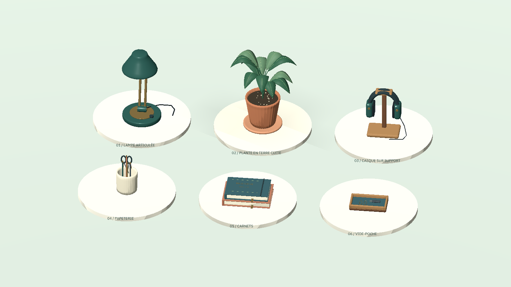
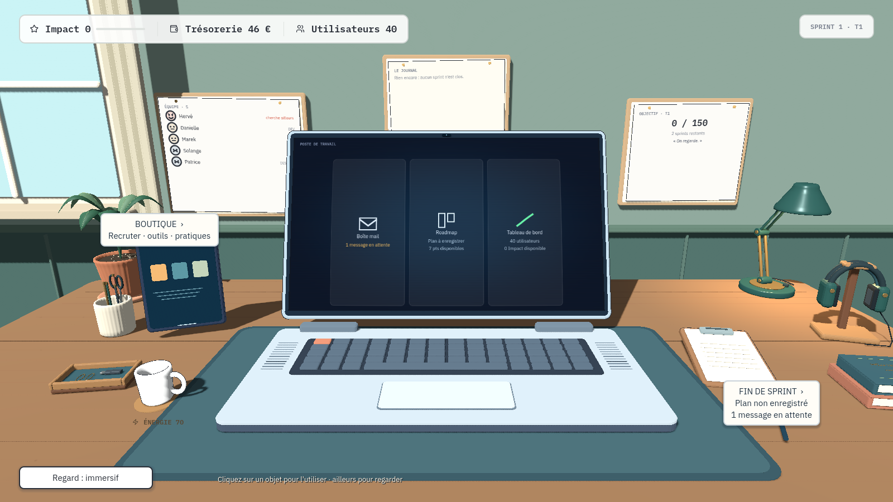
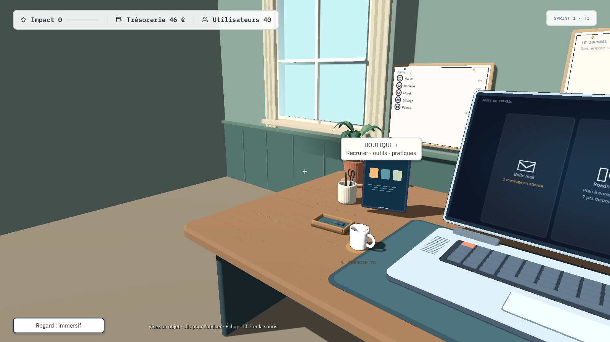
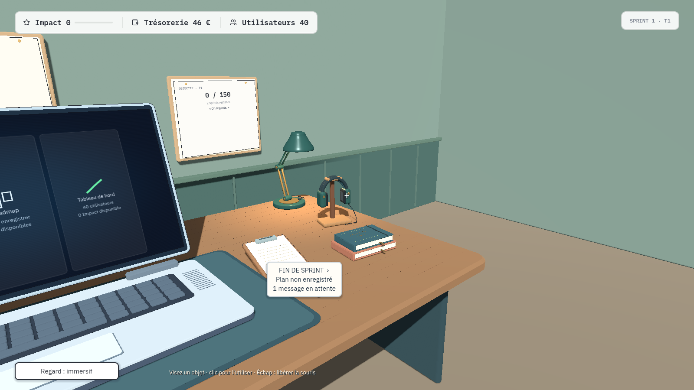
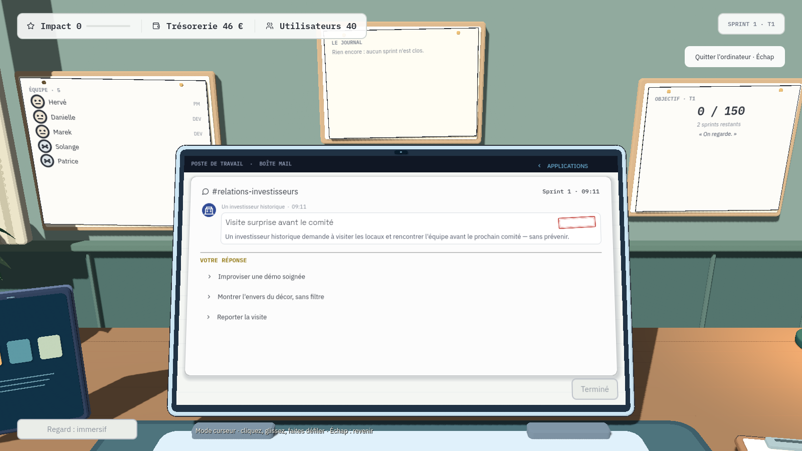

# Revue de lot — collection Atelier

Le poste de travail gagne des objets détaillés et une matière plus crédible
lorsque le joueur regarde autour de lui, tout en gardant ses accès de jeu.

## Périmètre vérifié

Six GLB originaux, assemblés dans une scène Godot éditable. Les anciennes lampe,
plante et pile de livres sont remplacées. Les nouvelles instances n'ont ni
collision ni script de gameplay ; les surfaces interactives et la caméra
restent celles de la branche `codex/prototype-hud-lisibilite`.

Les détails sont fabriqués hors du runtime : chanfreins, pivots de lampe,
parois des pots, feuilles courbées et nervurées, reliures, coussinets et petits
accessoires de papeterie. Le script Blender et le catalogue de budgets sont
versionnés avec les modèles. Les GLB représentent environ 1,6 Mio au total.

## Captures réellement relues












## Vérifications

Exécutées avec Godot **4.6.3**, GL Compatibility, Mesa llvmpipe (rendu logiciel),
à 1600×900. Le projet déclare Godot 4.7 ; cette version n'était pas installée
dans l'environnement de validation.

```sh
godot --headless --path game res://tests/smoke_test_logic.tscn
godot --headless --path game res://tests/smoke_test_ui.tscn
godot --headless --path game res://tests/smoke_test_fps.tscn
godot --headless --path game res://tests/smoke_test_desk_input.tscn
godot --headless --path game -s res://tests/score_resolver_cases.gd
```

**Cinq suites réussies, code de sortie 0, aucune erreur de script.** Résultats
dans `checks.txt`, avec les cinq logs complets. La boucle de simulation donne
**40/40 OK** (`random-40.txt`). Les avertissements ObjectDB à la fermeture
étaient déjà présents dans le test UI avant ce changement.

Le parcours `fps_visual_walkthrough.tscn` atteint une fin de mandat en mode
immersif et en mode confort, avec vrais clics routés vers les interfaces et
redimensionnement (`fps-walkthrough.txt`). Ce parcours choisit volontairement
de ne rien acheter ni livrer : il vérifie la navigation et les fins de run,
pas une stratégie gagnante.

Reproduire les images avec un serveur d'affichage disponible :

```sh
SHOT_DIR=/chemin/absolu godot --path game --audio-driver Dummy --resolution 1600x900 -s res://tests/atelier_review.gd
SHOT_DIR=/chemin/absolu godot --path game --audio-driver Dummy --resolution 1600x900 -s res://tests/atelier_gallery.gd
```

**Verdict : aucun bloqueur détecté sur le périmètre des assets.** Les tests et
les images ne constituent ni un playtest humain, ni un benchmark matériel.
Un essai humain sur la version cible de Godot reste utile pour apprécier le
confort du regard et les reflets en mouvement.
